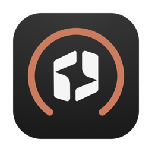
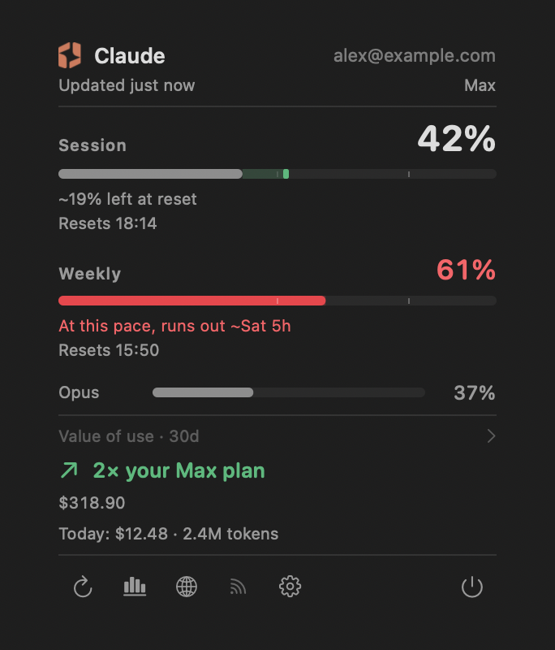
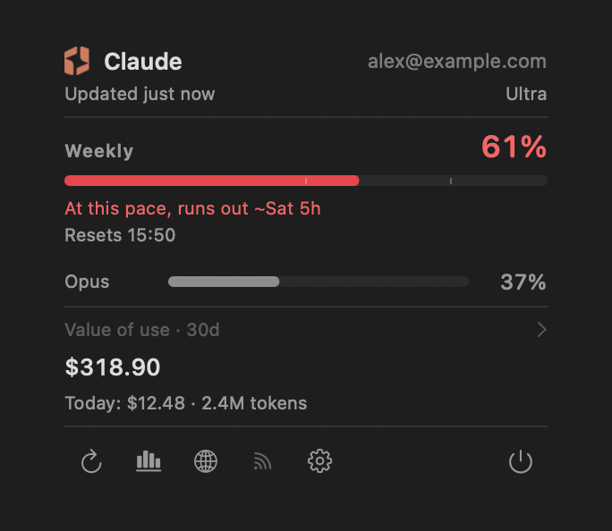
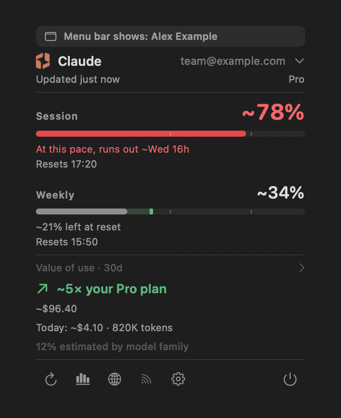
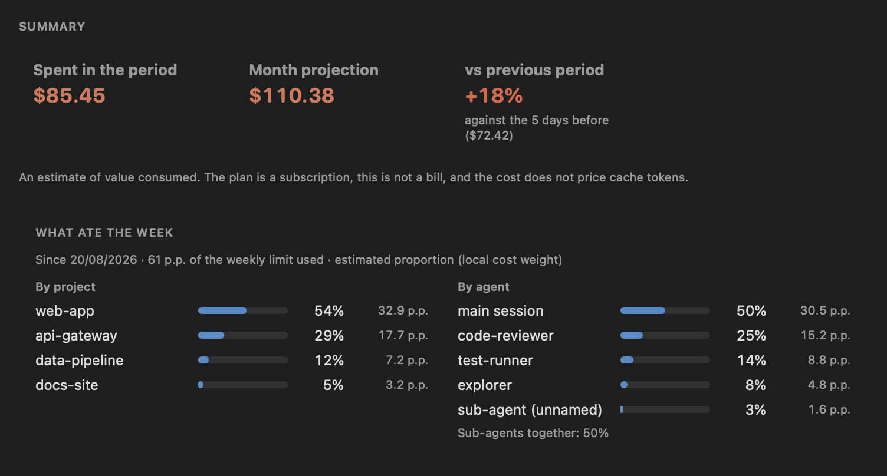
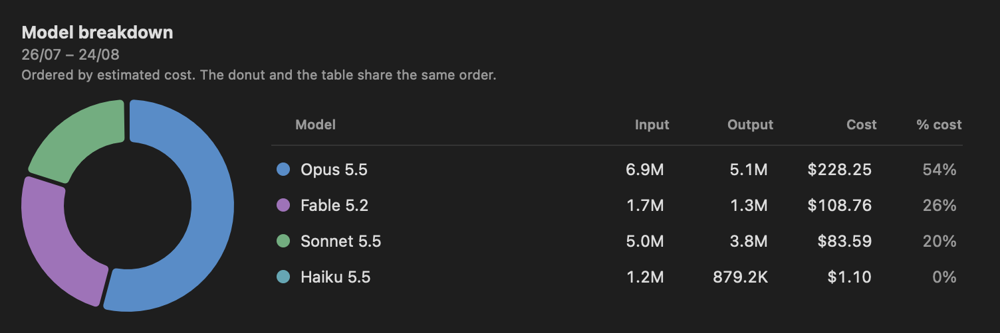
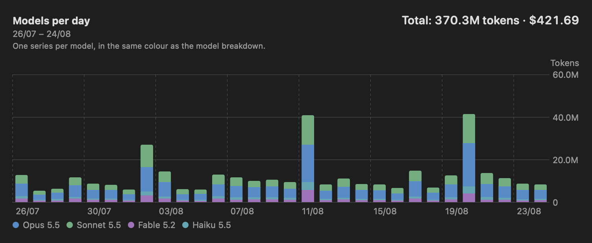

<p align="center">
  
</p>

<h1 align="center">exímIABar</h1>

<p align="center">
  <strong>Your Claude rate limits and spend, one glance away in the macOS menu bar.</strong>
</p>

<p align="center">
  <a href="https://github.com/eximIA-Ventures/eximiabar/releases/latest"></a>
  
  
  <a href="LICENSE"></a>
  
</p>

---

exímIABar lives in your menu bar, draws your current Claude rate-limit window as a compact
meter, and opens a popover with live utilization, pace, reset times and an estimated value of
your usage. A local dashboard breaks your Claude Code spend down by model, day and project, all
computed on your Mac from the session logs Claude Code already writes.

<p align="center">
  
  &nbsp;&nbsp;
  
</p>
<p align="center"><sub>Left: a Max plan (5-hour session + weekly + Opus). Right: an Ultra plan, which has no 5-hour limit, so the weekly window leads. Sample data.</sub></p>

<p align="center">
  
</p>
<p align="center"><sub>Focus on a second account: the header says which account the menu bar measures, the reading came from the CLI fallback and part of the cost was priced by model family, so every such number carries <code>~</code>. Sample data.</sub></p>

## Features

- **Live rate-limit meter** in the menu bar: the 5-hour session, the weekly window and the
  per-model weekly caps (Opus, and Fable when Anthropic reports it).
- **Claude Ultra aware.** Ultra has no 5-hour limit. When the usage response omits
  `five_hour` (or sends it as `null`), exímIABar shows no empty session bar, no reset line and
  no session alert, and the menu bar falls back to the weekly window.
- **Pace in plain words.** Each bar says what the pace means: "At this pace, runs out ~Thu 11h"
  or "~10% left at reset". The expected-use mark sits on the bar, with a tooltip. Colour follows
  gravity: neutral when healthy, amber behind pace or past 70%, red only when the window runs out
  before the reset or passes 90%. Model colours never use amber or red.
- **Numbers that say when they are estimates.** A reading scraped from the `claude` CLI, or a cost
  partly priced by model family (an unknown model id), is shown with `~` in the menu bar and the
  popover, with the estimated share written under the cost.
- **Value of use.** Estimated API-equivalent spend for today and the last 30 days, compared
  with your plan price.
- **Local cost dashboard.** A three-number summary (spent, month projection, change vs the
  previous period), spend and tokens by model (one ordering for donut and table, tokens or cost),
  by day and by project (with share and cumulative %), an hour×weekday / yearly activity grid, and
  CSV export.
- **What ate the week.** The "Since reset" period splits the weekly limit used since the last
  reset by project and by agent (main session vs. each sub-agent), as an estimated proportion.
- **Current model pricing.** Opus 5.5, Sonnet 5.5, Haiku 5.5, Fable 5.2 and the 4.x line are
  priced individually, including cache reads and cache writes (see below).
- **Multiple Claude accounts.** Accounts are captured as you log in and kept in a read-only
  roster; switching focus never changes the menu bar meter, which stays on the logged-in account,
  and the popover says "Menu bar shows: <account>" whenever the two differ.
- **Codex pane.** When `~/.codex/auth.json` exists, Codex session and weekly usage appear
  alongside Claude. No Codex login, no pane and no error.
- **English and Portuguese (Brazil)** interface.

<p align="center">
  
</p>
<p align="center">
  
</p>
<p align="center">
  
</p>
<p align="center"><sub>Dashboard sections rendered from the real SwiftUI views with fictitious sample data.</sub></p>

## Installation

1. Download `ExímIABar-<version>.zip` from the
   **[latest GitHub release](https://github.com/eximIA-Ventures/eximiabar/releases/latest)**.
2. Unzip it and move **ExímIABar.app** to `/Applications`.
3. The app is ad-hoc signed (no Apple Developer ID), so the first launch needs a
   right-click → **Open** to clear Gatekeeper.

Updates are built in: **Settings → About → Check for Updates** fetches and installs the latest
release in place.

> The Homebrew cask is not maintained past 1.4.1. Use the GitHub release above (or build from
> source) to get current versions.

### Requirements

- macOS 14 (Sonoma) or later
- [Claude Code](https://docs.anthropic.com/en/docs/claude-code) installed and logged in (`claude`)

## Supported models

Cost is estimated locally from `~/.claude/projects/**/*.jsonl`. Prices come from the
[models.dev](https://models.dev) catalog when reachable, with this built-in table as the
fallback (USD per million tokens):

| Model | Input | Output | Cache read |
|:---|---:|---:|---:|
| Fable 5.2 | 8 | 40 | 0.20 |
| Fable 5.1 / Fable 5 | 10 | 50 | 1.00 |
| Mythos 5.2 | 8 | 40 | 0.80 |
| Mythos 5.1 | 10 | 50 | 1.00 |
| Opus 5.5 | 4 | 20 | 0.20 |
| Opus 5 · 4.8 · 4.7 · 4.6 · 4.5 | 5 | 25 | 0.50 |
| Opus 4.1 · 4 | 15 | 75 | 1.50 |
| Sonnet 5.5 | 2 | 10 | 0.10 |
| Sonnet 5 | 2 | 10 | 0.20 |
| Sonnet 4.6 · 4.5 · 4 · 3.7 · 3.5 | 3 | 15 | 0.30 |
| Haiku 5.5 (prompts up to 100K) | 0.10 | 0.50 | 0.01 |
| Haiku 4.5 | 1 | 5 | 0.10 |
| Haiku 3.5 | 0.80 | 4 | 0.08 |

- Cache writes (5-minute TTL) are priced at 1.25× input; cache reads without a published price
  at 0.1× input.
- Model IDs are normalized before lookup: dates (`-20261001`), `anthropic.` / `anthropic/`
  prefixes and Bedrock / Vertex suffixes are removed, and the longest known ID wins, so
  `claude-opus-4-8` is never priced as `claude-opus-4`.
- An unknown model is priced as the current model of its family (a future `claude-opus-*` as
  Opus 5.5, and so on), and only then as Sonnet 5.5.

## Privacy

- **Read-only credentials.** exímIABar reads the OAuth credentials your `claude` CLI already
  stores (macOS Keychain, falling back to `~/.claude/.credentials.json`) and never writes or
  exports them. A denied Keychain prompt backs off instead of nagging.
- **Minimal network.** Anthropic is called only for the usage endpoint (plus OAuth token renewal
  when needed), the same endpoints the CLI uses. Pricing may fetch the public models.dev catalog;
  updates check GitHub Releases.
- **Cost stays on your Mac.** Session logs are parsed locally and never uploaded.

## Build from source

Requires Swift 6.2 (Xcode 16+ or the Command Line Tools).

```bash
make build && sudo make install
```

- `make build` produces a universal (arm64 + x86_64), ad-hoc-signed `dist/ExímIABar.app`.
- `make install` copies it to `/Applications/` (needs `sudo`); `make install-user` copies it to
  `~/Applications/` without `sudo`.

| Target | Action |
|--------|--------|
| `make build` | Build the signed `.app` into `dist/` |
| `make install` | Copy to `/Applications/` (may need `sudo`) |
| `make install-user` | Copy to `~/Applications/` (no `sudo`) |
| `make uninstall` | Remove from `/Applications/` (may need `sudo`) |
| `make clean` | Remove `dist/` and `.build/` |
| `make icon` | Regenerate `AppIcon.icns` |

Quick debug build and the test suite:

```bash
swift build --arch arm64
Scripts/run-tests.sh          # use this instead of a bare `swift test` on machines without Xcode
```

The README screenshots are rendered from the real views with sample data:

```bash
EXB_README=1 Scripts/run-tests.sh --filter ReadmeScreenshotRenderer   # writes docs/images/*.png
```

## License

MIT, see [`LICENSE`](LICENSE).

exímIABar is a derivative work of [**CodexBar**](https://github.com/steipete/CodexBar) by Peter
Steinberger, used under the MIT License. It adapts CodexBar's Claude OAuth pipeline and visual
design into a Claude-focused, freeze-free menu bar monitor.
